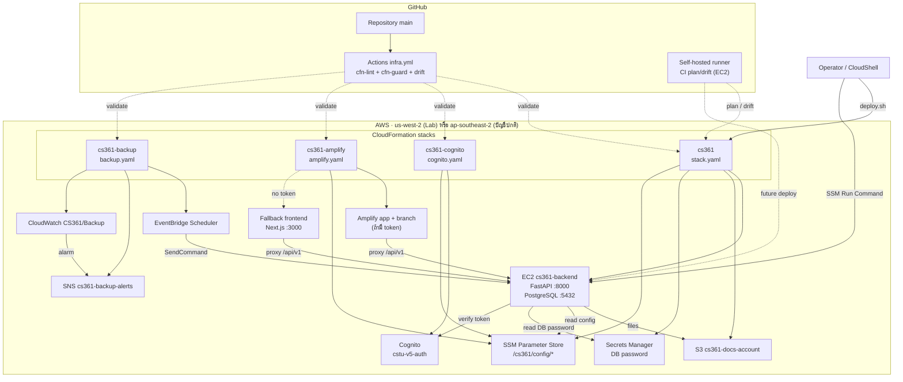
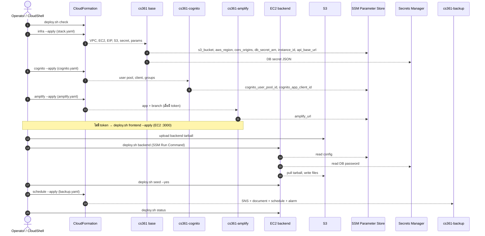
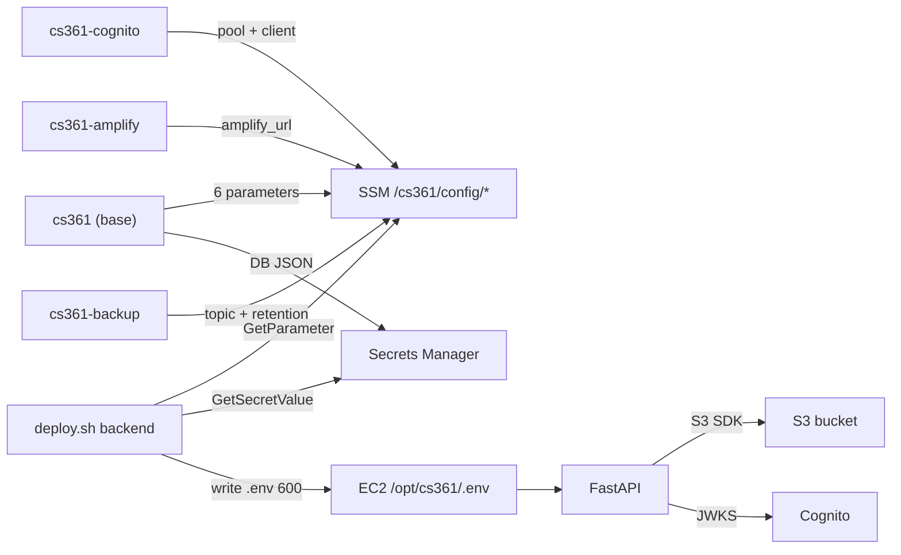
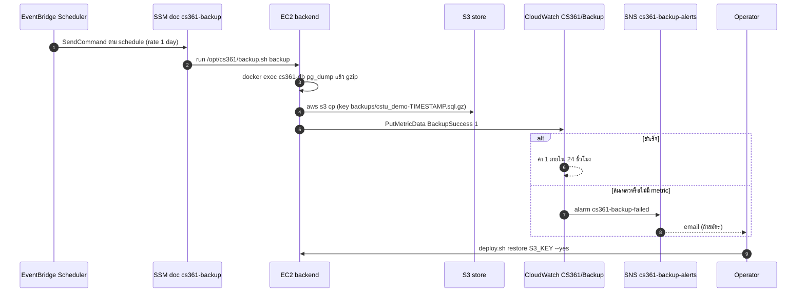

# สถาปัตยกรรมระบบ V5

> สถานะ: ทดสอบใน Learner Lab 8 พฤศจิกายน 2026 (base stack, Cognito, backend,
> fallback frontend, backup/restore/alert, drift) · วันที่: 8 พฤศจิกายน 2026
> ใช้กับ V5 — สร้างและปรับใช้ infrastructure/deployment ซ้ำด้วย automation หรือ IaC
> Amplify stack/build ยัง N/A เพราะไม่มี token; teardown + recreate ยัง TBD
> ผลการรันจริงและหลักฐานอยู่ใน [แผนทดสอบ V5](../evidence/v5-validation.md)

V5 ไม่ได้เพิ่มความสามารถทางธุรกิจใหม่ในหน้าเว็บ
แต่เปลี่ยนวิธีสร้างและ deploy ให้ตรวจซ้ำได้: แยก infrastructure เป็น stack ย่อย
ย้าย config ไป SSM Parameter Store, ย้ายรหัสผ่านฐานข้อมูลไป Secrets Manager
เพิ่ม backup อัตโนมัติ และตรวจ template ใน CI
ข้อจำกัดของ Learner Lab ทำให้ frontend ต้องมีทางเลือกสำรองบน EC2
เมื่อ Amplify ใช้ไม่ได้

เปิด [v5-deploy-architecture.html](v5-deploy-architecture.html) เพื่อดู diagram พร้อมตารางขั้นตอน

## องค์ประกอบหลัก



### ตารางส่วนประกอบ

| ส่วน | ไฟล์/บริการ | หน้าที่ใน V5 |
|---|---|---|
| Base stack | `infra/new-account/stack.yaml` (stack `cs361`) | VPC, public subnet, security group, EC2, Elastic IP, S3, Secrets Manager secret, SSM parameter และ IAM แบบมีเงื่อนไข |
| Cognito stack | `infra/new-account/cognito.yaml` (stack `cs361-cognito`) | User pool `cstu-v5-auth`, app client `cstu-backend`, กลุ่มบทบาท 5 กลุ่ม, SSM parameter |
| Amplify stack | `infra/new-account/amplify.yaml` (stack `cs361-amplify`) | Amplify app `WEB_COMPUTE`, branch `main`, environment variables, SSM `amplify_url`; สร้างเฉพาะเมื่อมี token |
| Backup stack | `infra/new-account/backup.yaml` (stack `cs361-backup`) | SNS topic, SSM Command document, EventBridge Scheduler, CloudWatch alarm |
| Deploy script | `infra/new-account/deploy.sh` | plan/apply ทีละ stack, deploy backend/frontend ผ่าน SSM, seed, backup, restore, status, teardown (`--purge` ลบ S3/Cognito ที่ retain) |
| Backup helper | `infra/new-account/backup.sh` | `pg_dump` ขึ้น S3, publish metric, restore จาก S3 |
| CI | `.github/workflows/infra.yml` | ตรวจ template ด้วย `cfn-lint`/`cfn-guard` และตรวจ drift ตามรอบ |
| Runner | EC2 + GitHub self-hosted runner | ใช้ `LabInstanceProfile`; job `plan`/`drift` ของ CI ต้องใช้ runner นี้; workflow deploy backend ยังไม่ผูกใน V5 |

### Base stack

- **Network**: VPC `10.40.0.0/16`, public subnet เดียว, internet gateway, route table
- **Security group**: เปิด `80`/`443` (Caddy HTTPS), `8000` (API) และ `3000`
  (fallback frontend) จาก `0.0.0.0/0`
  **ไม่เปิดพอร์ต 22**; PostgreSQL ไม่ถูก publish ออกนอก Docker network
- **HTTPS edge (optional)**: `deploy.sh tls` รัน Caddy บน instance (พอร์ต 80/443)
  ขอ certificate จาก Let's Encrypt สำหรับ `<Elastic-IP>.sslip.io` หรือ `SITE_DOMAIN`
  แล้ว reverse proxy ไป `cs361-frontend:3000`; cert/data อยู่ใต้ `/opt/cs361/caddy`
- **EC2**: `t3.micro`, Amazon Linux 2023, EBS gp3 20 GB เข้ารหัส, swap 2 GB สำหรับ build
  และ IMDSv2 บังคับ (`HttpTokens: required`)
- **Elastic IP**: ทำให้ `ApiBaseUrl` และ `API_PROXY_TARGET` ไม่เปลี่ยนเมื่อ stop/start
- **S3**: bucket `cs361-docs-<account-id>` ปิด public access, เปิด versioning,
  เข้ารหัส AES256 และ lifecycle ลบ `backups/` ตาม `BackupRetentionDays` (ค่าเริ่มต้น 30 วัน)
- **Secrets Manager**: secret JSON `{"username":"cstu","dbname":"cstu_demo","password":"<generated>"}`
  สร้างด้วย `GenerateSecretString` (32 ตัวอักษร ไม่มีเครื่องหมายวรรคตอน)
- **IAM**: `LabMode=true` ใช้ `LabInstanceProfile`/`LabRole` และไม่สร้าง role;
  `LabMode=false` สร้าง `AppRole`, instance profile และ `BackupSchedulerRole`
  ที่มีสิทธิ์เท่าที่จำเป็น

## ลำดับการ deploy

ลำดับนี้สำคัญเพราะ stack หลังอ่าน output/SSM ของ stack ก่อน
และ backend ต้องมีทั้ง Cognito IDs, secret และ bucket ก่อนเริ่มทำงาน



| ลำดับ | คำสั่ง | ผลที่ต้องได้ | เหตุผลที่ต้องอยู่ลำดับนี้ |
|---|---|---|---|
| 1 | `./deploy.sh check` | identity, region, mode และ service probes ผ่าน | ตรวจ session/region ก่อนสร้าง resource |
| 2 | `./deploy.sh infra --apply` | stack `cs361` CREATE/UPDATE_COMPLETE และ outputs ครบ | เป็นฐานของทุก stack; ให้ instance, bucket, secret, SSM |
| 3 | `./deploy.sh cognito --apply` | stack `cs361-cognito` และ pool/client/group | backend ต้องใช้ pool ID/client ID |
| 4 | `./deploy.sh amplify --apply` หรือ `./deploy.sh frontend --apply` | Amplify app/branch หรือ frontend container :3000 | ให้ URL สำหรับ CORS และหน้าเว็บ |
| 4.1 | `./deploy.sh tls` | Caddy 80/443 + certificate + `https://<domain>` | ต้องมี frontend container ก่อน; SG เปิด 80/443 |
| 5 | `./deploy.sh backend` | `/api/v1/health` ผ่าน | อ่าน secret/SSM และเริ่ม DB/API |
| 6 | `./deploy.sh seed --yes` | ข้อมูลสมมติใน `cstu_demo` | ต้องมี backend image และ DB ก่อน |
| 7 | `./deploy.sh schedule --apply` | backup stack และ schedule ENABLED | ต้องมี instance ID, bucket และ topic ก่อน |
| 8 | `./deploy.sh status` | API และ frontend ตอบสนอง | ยืนยันผลหลัง deploy |

> `seed` ลบข้อมูลทั้งหมดใน `cstu_demo` ต้องมี `--yes` และควรมี backup ก่อนเสมอ
> `schedule` เป็น stack สุดท้ายเพราะใช้ output ของ base และเขียน parameter เพิ่ม

### Teardown

- `./deploy.sh teardown --yes` ลบ stack ทั้งหมด แต่เก็บ S3 bucket และ Cognito pool
  ไว้ตาม `DeletionPolicy: Retain`
- `./deploy.sh teardown --yes --purge` ลบ S3 bucket (ทุก object/version) และ
  Cognito pool ด้วย ใช้เมื่อต้องการ recreate จากศูนย์เท่านั้น
- ทั้งสองแบบลบ EC2, EBS/ฐานข้อมูล, secret, SSM parameter ของ stack และ schedule/alarm
  จึงต้อง `./deploy.sh backup` ก่อนเสมอ

## การไหลของ config และ secrets

V5 แยก “ค่าที่ไม่ลับ” กับ “ความลับ” ออกจากกัน:

- **SSM Parameter Store** เก็บชื่อ bucket, region, CORS origin, secret ARN, instance ID,
  API URL, Cognito IDs, Amplify URL และค่าของ backup
- **Secrets Manager** เก็บ JSON ที่มีรหัสผ่านฐานข้อมูลเพียงแห่งเดียว
- **ไม่มีความลับใน Git, GitHub Secrets หรือ template output**
- `deploy.sh backend` อ่านค่าทั้งสองแหล่งแล้วเขียน `/opt/cs361/.env` สิทธิ์ `600` บน EC2
- backend ใช้ environment variables ตามปกติ ไม่เรียก Secrets Manager ทุก request



### Parameter และ secret ที่ใช้ร่วมกัน

| ชื่อ | เจ้าของ | ใช้ทำอะไร |
|---|---|---|
| `/cs361/config/s3_bucket` | base stack | ชื่อ bucket สำหรับไฟล์และ backup |
| `/cs361/config/aws_region` | base stack | region ที่ backend/S3 ใช้ |
| `/cs361/config/cors_origins` | base stack | origin เริ่มต้นที่อนุญาตให้เรียก API |
| `/cs361/config/db_secret_arn` | base stack | ARN ของ secret ที่เก็บรหัสผ่าน DB |
| `/cs361/config/instance_id` | base stack | instance เป้าหมายของ SSM |
| `/cs361/config/api_base_url` | base stack | `http://<Elastic IP>:8000` |
| `/cs361/config/cognito_user_pool_id` | Cognito stack | ตรวจ token |
| `/cs361/config/cognito_app_client_id` | Cognito stack | client ที่ออก token |
| `/cs361/config/amplify_url` | Amplify stack | URL สำหรับ CORS (มีเฉพาะเมื่อสร้าง app) |
| `/cs361/config/backup_topic_arn` | backup stack | topic สำหรับแจ้งเตือน |
| `/cs361/config/backup_retention_days` | backup stack | จำนวนวันเก็บ backup (ตรงกับ lifecycle) |

> `backup_topic_arn` และ `backup_retention_days` เป็น parameter ที่ backup stack เพิ่ม
> ไม่อยู่ในรายการ interface เริ่มต้นของแผน V5 แต่เป็นส่วนเพิ่มที่ไม่เปลี่ยนสัญญาเดิม

### Secret JSON

```json
{
  "username": "cstu",
  "dbname": "cstu_demo",
  "password": "<generated by CloudFormation>"
}
```

- `deploy.sh backend` อ่านค่าแล้วเขียน `POSTGRES_*` ลง `db.env` และ `DATABASE_URL` ลง `.env`
- ถ้า secret เปลี่ยน `deploy.sh backend` จะ `ALTER USER` ให้ตรงกับค่าใหม่ (ไม่พิมพ์รหัสผ่าน)
- การหมุนรหัสผ่านเป็นขั้น manual: update secret แล้วรัน backend (ดู runbook)

## Authentication: Cognito และ local auth fallback

Cognito เป็นค่าเริ่มต้นของ V5 (`AUTH_BACKEND=cognito`):

- `cs361-cognito` สร้าง user pool, app client และกลุ่มบทบาท
- backend ใช้ `COGNITO_REGION`, `COGNITO_USER_POOL_ID`, `COGNITO_APP_CLIENT_ID`
- V5 run นี้ทดสอบ login ผ่าน Cognito แล้ว (role `admin`)

local auth เป็น **fallback** สำหรับ environment ที่สร้าง Cognito ไม่ได้:

- เปิดด้วย `AUTH_BACKEND=local`; ไม่ต้อง deploy stack `cs361-cognito`
- base stack สร้าง `LocalAuthSecret` ใน Secrets Manager เฉพาะเมื่อ `AuthBackend=local`
- `deploy.sh backend` เขียน `AUTH_BACKEND`/`LOCAL_AUTH_SECRET` และ mount
  `/opt/cs361/local-auth` ไปที่ `/app/storage` เพื่อเก็บ password file
- `local_auth_setup.py` สร้าง/rotate บัญชีทดสอบ; รหัสผ่านอยู่บน instance โหมด `0600`
- ไม่มี MFA/password reset/federation; ใช้เฉพาะ demo/lab
- อย่าสลับ Cognito ↔ local ในฐานข้อมูลเดียวกันโดยไม่ล้าง local users
  (`users.email` unique และ local users ใช้ `cognito_sub=local:<email>`)

## การสำรองและกู้คืน



- **Schedule**: `rate(1 day)` ค่าเริ่มต้น; เปลี่ยนได้ผ่าน `BACKUP_SCHEDULE`
- **Document**: `cs361-backup` รัน `/opt/cs361/backup.sh backup`
- **Retention**: S3 lifecycle ลบ object ใต้ `backups/` ตาม `BackupRetentionDays`
- **Alarm**: namespace `CS361/Backup`, metric `BackupSuccess`, `TreatMissingData: breaching`
  แปลว่าถ้าไม่มี metric ภายใน 24 ชั่วโมงจะถือว่าล้มเหลว
  หลังสร้าง stack ใหม่ alarm อาจเป็น `ALARM` จนกว่า backup ครั้งแรกจะ publish ค่า `1`
  ซึ่งเป็นพฤติกรรมที่ตั้งใจ; ให้รัน `deploy.sh backup` หนึ่งครั้งหลัง apply
- **Restore**: `deploy.sh restore` ดาวน์โหลด backup, หยุด backend ชั่วคราว, restore แล้ว start กลับ
- **ข้อจำกัด Lab**: schedule ทำงานเฉพาะเมื่อ Lab session เปิดและ EC2 ทำงาน;
  ต้องสั่ง `deploy.sh backup` ด้วยมือเมื่ออยู่นอกช่วงนั้น

## เทมเพลตและ outputs

| ไฟล์ | Stack | Resource หลัก | Outputs |
|---|---|---|---|
| `infra/new-account/stack.yaml` | `cs361` | VPC, subnet, SG, EC2, EIP, S3, secret, SSM, IAM (conditional) | `InstanceId`, `ApiBaseUrl`, `BucketName`, `DbSecretArn`, `ConfigPrefix`, `InstanceProfileName`, `SecurityGroupId`, `FrontendUrl`, `SchedulerRoleArn` |
| `infra/new-account/cognito.yaml` | `cs361-cognito` | User pool, app client, กลุ่ม `public/student/coordinator/staff/admin`, SSM IDs | `UserPoolId`, `AppClientId`, `UserPoolName` |
| `infra/new-account/amplify.yaml` | `cs361-amplify` | Amplify app `WEB_COMPUTE`, branch `main`, SSM `amplify_url` (conditional) | `AppId`, `DefaultDomain`, `BranchUrl`, `CorsOrigin` |
| `infra/new-account/backup.yaml` | `cs361-backup` | SNS topic, SSM document, Scheduler, CloudWatch alarm, SSM backup params | `TopicArn`, `BackupDocumentName`, `ScheduleName` |

### Output ที่ใช้ต่อกัน

- `cs361` → `ApiBaseUrl` ถูกส่งเป็น parameter ให้ `cs361-amplify`
- `cs361` → `InstanceId`, `BucketName`, `SchedulerRoleArn` ถูกส่งให้ `cs361-backup`
- `cs361-cognito` → `UserPoolId`, `AppClientId` ถูกอ่านโดย `deploy.sh backend`
- `cs361-amplify` → `BranchUrl` ถูกอ่านโดย `deploy.sh status`
- ถ้าไม่มี Amplify stack ให้ใช้ `cs361` → `FrontendUrl` แทน

## CI และ drift

`.github/workflows/infra.yml` (V5-7) มี 3 job:

1. **lint** (ubuntu-latest): ติดตั้ง `cfn-lint` และ `cfn-guard`
   (ผ่าน `scripts/install_cfn_guard.sh` ที่ pin version), ตรวจ template ทั้งหมดใต้ `infra/`,
   ตรวจกฎใน `.cfn-guard/rules.guard` และ `bash -n` สคริปต์ infrastructure
2. **plan** (self-hosted label `cs361`): สร้าง CloudFormation change set ของ base stack
   ให้ reviewer ดู; ไม่ apply
3. **drift** (self-hosted label `cs361`, รายวันหรือ manual): เรียก `detect-stack-drift`
   และ fail ถ้ามี resource `MODIFIED`/`DELETED`

CI ไม่ deploy อัตโนมัติ; การ apply ยังเป็นคำสั่งของคนหรือ runner ที่ได้รับอนุญาต
runner ใช้ `LabInstanceProfile`; ไม่มี OIDC หรือ AWS secret ใน workflow

CI เป็นด่านตรวจก่อน merge ไม่ใช่ตัวแทนการทดสอบใน Lab
ผลรันจริงต้องบันทึกใน [v5-validation.md](../evidence/v5-validation.md)

## ค่าใช้จ่ายโดยประมาณ

| รายการ | ค่าประมาณ |
|---|---|
| EC2 t3.micro + EBS 20 GB + Elastic IP | ~$13/เดือน (us-west-2, เปิดตลอด) |
| S3 ไฟล์และ backup ขนาดเล็ก | ไม่กี่เซนต์ถึง $1 |
| Secrets Manager 1 secret | ~$0.40/เดือน |
| Cognito (ผู้ใช้ทดสอบไม่กี่คน) | อยู่ใน free tier |
| SSM Parameter Store (standard) | ฟรี |
| EventBridge Scheduler 1 schedule/วัน | แทบไม่มีค่าใช้จ่าย |
| SNS email แจ้งเตือนไม่กี่ฉบับ | แทบไม่มีค่าใช้จ่าย |
| Amplify build | ขึ้นกับจำนวน build; อาจมีค่าใช้จ่ายถ้าเกิน free tier |
| Self-hosted runner (ถ้าเปิดตลอด) | ~$12/เดือน; หยุดเมื่อไม่ใช้ |

ตัวเลขเป็นค่าประมาณและยังไม่รวมเครดิต Learner Lab
V5 ไม่ได้เพิ่ม load balancer, Multi-AZ หรือ RDS จึงยังอยู่ในระดับเดียวกับ V4

## สิ่งที่เปลี่ยนจาก V4

| เรื่อง | V4 | V5 |
|---|---|---|
| Infrastructure | CloudFormation ไฟล์เดียว + Console | 4 stack ย่อย, change set, drift |
| Config | `.env` ที่เขียนจากสคริปต์ | SSM Parameter Store + Secrets Manager |
| Cognito | `provision_cognito.py` สร้าง pool | `cognito.yaml` เป็นเจ้าของ pool/client/group |
| Amplify | สร้างใน Console | `amplify.yaml` เมื่อมี token, fallback EC2 |
| Backup | `deploy.sh backup` ด้วยมือ | Scheduler + SNS + CloudWatch alarm + restore |
| CI | tests/build | เพิ่ม `cfn-lint`/`cfn-guard` และ drift |
| Backend deploy | CloudShell + SSM | เหมือนเดิม; มี ADR/runbook สำหรับ self-hosted runner; V5-5 (OIDC) ปิดเป็น not planned |

## ข้อจำกัดและความเสี่ยง

- **Amplify build ยังไม่ยืนยัน** ใน Learner Lab; fallback frontend บน EC2 เป็นทางที่ใช้ได้
- **IAM ถูกจำกัด**: `LabMode=true` ต้องไม่สร้าง role; `LabRole` กว้างและใช้ร่วมกับ runner
- **Schedule ทำงานเฉพาะ Lab active**: backup อัตโนมัติไม่ใช่การรับประกันใน Lab
  (แต่ schedule `cs361-backup` ถูกทดสอบแล้วว่า ENABLED และรันสำเร็จใน session ที่เปิดอยู่)
- **Runner ยังไม่ผูก workflow backend**: V5-5 ปิด; CI `plan`/`drift` ใช้ runner
  แต่ workflow deploy backend เป็นขั้นถัดไป
- **HTTPS ถึง browser แล้ว** ผ่าน Caddy; แต่ Caddy → frontend/backend เป็น HTTP
  ภายใน Docker และ API `:8000` ยังเปิด HTTP สำหรับ fallback/Amplify path
  (ถ้าต้องการปิด 8000 ต้องแก้ `ApiBaseUrl`/health check และทดสอบ path อื่น)
- **ไม่มี Multi-AZ/load balancer**: EC2 เครื่องเดียวและ PostgreSQL container เดียว
- **CI workflow**: lint/cfn-guard ผ่านในเครื่องแล้ว; GitHub Actions ยังไม่รันใน session นี้
  เพราะไม่ push; ต้องตรวจผล Actions เมื่อเปิด PR
- **Teardown**: `teardown --yes` เก็บ S3/Cognito ไว้; `--purge` ลบทั้งสองอย่างถาวร
  จึงต้อง backup และใช้ `--purge` เฉพาะเมื่อต้องการ recreate จากศูนย์

## เอกสารที่เกี่ยวข้อง

- [เครื่องมือ IaC V5](../decisions/v5-iac-tooling.md)
- [ช่องทาง deploy backend V5](../decisions/v5-backend-deploy.md)
- [ขอบเขต Learner Lab V5](../decisions/v5-learner-lab-scope.md)
- [Baseline V5](../evidence/v5-baseline.md)
- [แผนทดสอบ V5](../evidence/v5-validation.md)
- [คู่มือ deploy V5](../runbooks/v5-deploy.md)
- [บันทึก Amplify spike](../notes/v5-amplify-spike.md)
- [สถาปัตยกรรม V4](v4-architecture.md)
